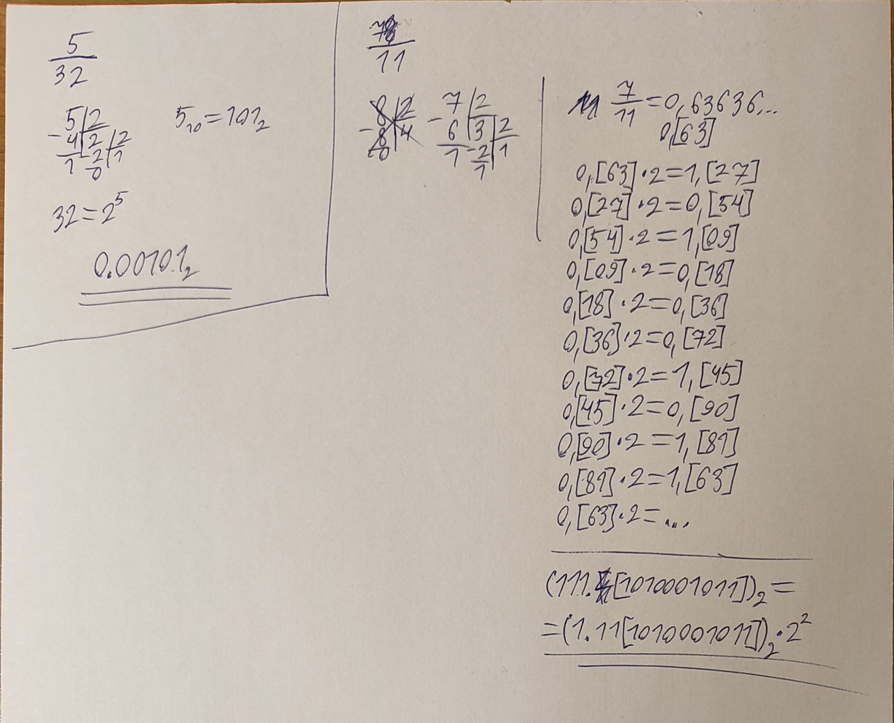
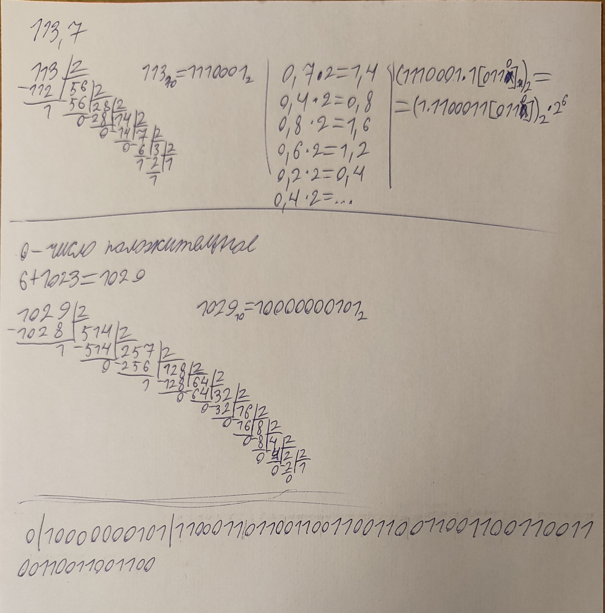
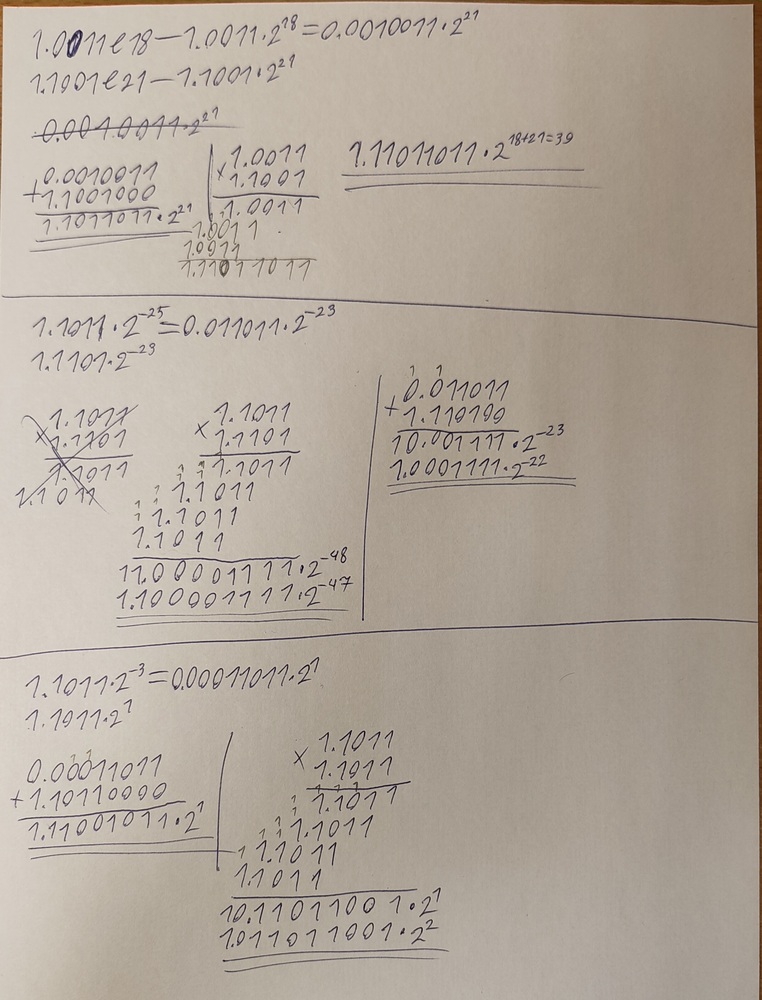

# Языки программирования
## Лабораторная работа 5

### Задание 1 **(2)** ✅
*Переведите в двоичную запись два произвольных рациональных числа (числа вида* $\frac{p}{q}$).
*У одного из чисел знаменатель должен быть степенью двойки (32), а у другого - некоторым числом
от 9 до 12.*

*Запись второго числа будет содержать период. Его надо найти. При решении задачи нельзя 
использовать вычислительную технику. Процесс решения должен быть представлен в отчете.*
---



### Задание 2 **(3)** ✅
*Переведите в двоичную запись и найдите машинное представление в типе* **double**
*для произвольного вещественного числа большего, чем 100 с одним знаком после точки, например
для* $113.7$. *Цифра после точки не должна быть нулем или пятеркой.*

*При решении задачи нельзя 
использовать вычислительную технику. Процесс решения должен быть представлен в отчете.*
---



### Задание 3 **(3)** ✅
*Найдите сумму и произведение для записанных далее пар чисел. Числа заданы в двоичной записи 
в экспоненциальном виде. Ответ необходимо записать в нормализованной экспоненциальном виде.*

* 1.0011e18 и $1.1001e21;
* 1.1011e-25 и, $1.1101e-23;
* 1.1011e-3 и $1.1011e1.
  
*При решении задачи нельзя 
использовать вычислительную технику. Процесс решения должен быть представлен в отчете.*
---



### Задание 4 **(2)**
*Рассмотрим следующий пример в IDLE Python*
```
>>> x = 99.99
>>> int(x/10+0.001)
9
```
*Результат должен был быть равен 10, однако оказался другим. Почему так произошло?
Как исправить программу, чтобы она корректно переводила вещественные числа в целые?*


### Задание 5 **(2)**
*Рассмотрите следующую программу. Объясните результаты ее работы. В частности,
как величина* $y$ *повлияла на ответ?*
```
x = 1/3
y = 1
for i in range(20):
    print((x+y)-y)
    y*=10
```
*В отчете требуется привести вычисления для оценки погрешности.*


### Задание 6 **(2)**
*Для какого минимального значения* $n$ *программа на С++ выведет* **inf**? *Объясните
ответ.* *Что произойдет, если тип* **double** *заменить на* **long double**?
```
int n=...;
double s = pow(2, n);
std::cout << std::fixed << s << std::endl;
```


### Задание 7 **(2)**
*Допишите что-либо вместо многоточия программе на С++, чтобы программа при запуске выдавала ответ* **yes**.
```
double s = ...;
if (s != s)
  std::cout << "yes";
```


### Задание 8 **(2)**
*Какое минимальное натуральное число при преобразовании в тип* **double** *записывается с погрешностью? Объясните
ответ. Почему следующее за ним число уже выводится без погрешности?*


### Задание 9 **(2)** ✅ (папка practicum, 03.py)
*Напишите программу для решения следующей задачи.*

*Даны четыре рациональных числа. (Рациональное число - это число вида*
$\frac{p}{q}$, *где* $p$ *и* $q$ - *целые числа.) Напишите программу, которая сравнит сумму
двух первых чисел с суммой двух последних чисел. Программа должна выводить* $1$, $0$ *или* $-1$
*в зависимости от результатов сравнения. Решение можно проверить в проверяющей системе*
[http://olymp3.isu.ru/cgi-bin/new-client?contest_id=102](http://olymp3.isu.ru/cgi-bin/new-client?contest_id=102), *задача 03*.
